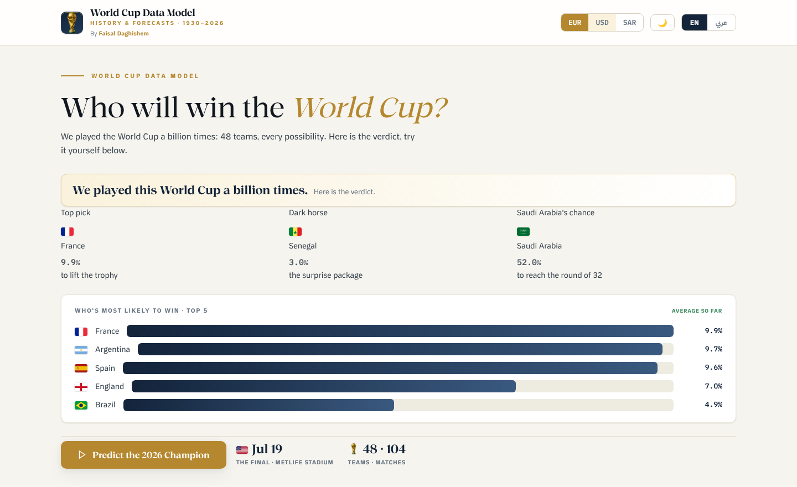

# World Cup Data Model

An interactive dashboard for the 2026 FIFA World Cup. It covers match and tournament forecasts, the 48 teams and 12 groups, squad market values, and World Cup history since 1930. The page works in English and Arabic.

**Live page:** https://faisaldaghishem.github.io/World-Cup-Dashboard-Predict-Model/

## What's in it

- **2026 Forecast:** each team's chance of winning the title. A button runs a new simulated tournament in the browser.
- **Saudi Arabia:** every World Cup match the national team has played, its 2026 outlook, and comparisons with the other Arab teams.
- **Groups:** the 12 groups, with each team's chance of qualifying.
- **Teams & Value:** squad and player market values in EUR, USD or SAR.
- **History:** every final since 1930, award winners, and all-time top scorers.
- **Methodology:** how the model works and where its limits are.

## How the model works

- **Team strength:** FIFA ranking points (April 2026) are used as an Elo-style rating. The three host countries get a home advantage.
- **Match outcome:** a logistic Elo win expectancy is blended equally with a Poisson scoreline model. The result is rescaled into win, draw and loss probabilities.
- **Tournament:** a Monte Carlo simulation of the full 48-team bracket, run until the estimates settle.

The page was built in June 2026, before the tournament started.

## Data sources

FIFA (rankings as of 1 April 2026), Opta, Transfermarkt, Saudipedia and Planet Football.

## Run it locally

The dashboard is a single HTML file with no dependencies. Open `worldcup_dashboard_predict_model.html` in any browser. Charts use Chart.js 4.4.0 (MIT licence), included in the file so the page works offline.

---

Faisal Daghishem · [LinkedIn](https://linkedin.com/in/FaisalDaghishem)
